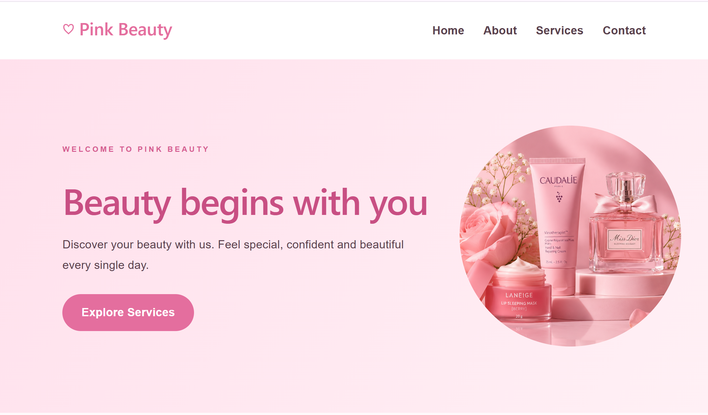
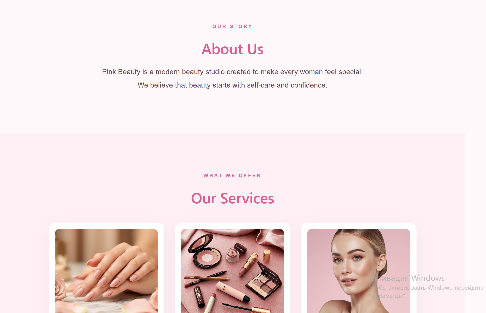
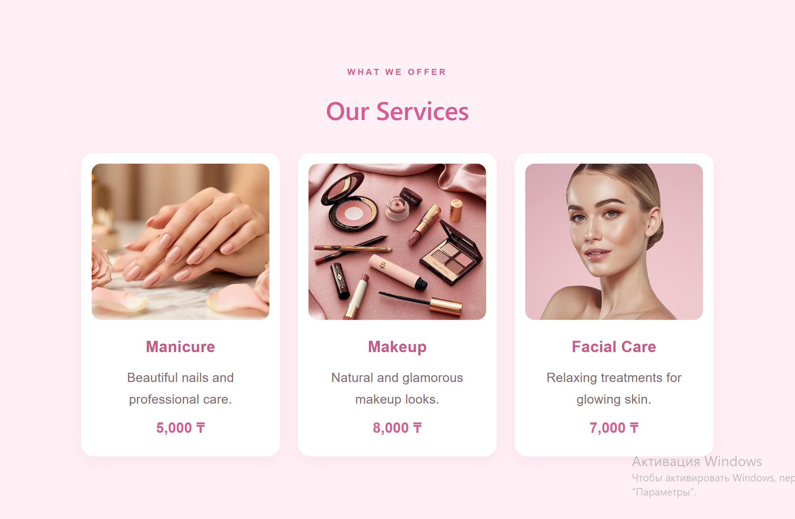
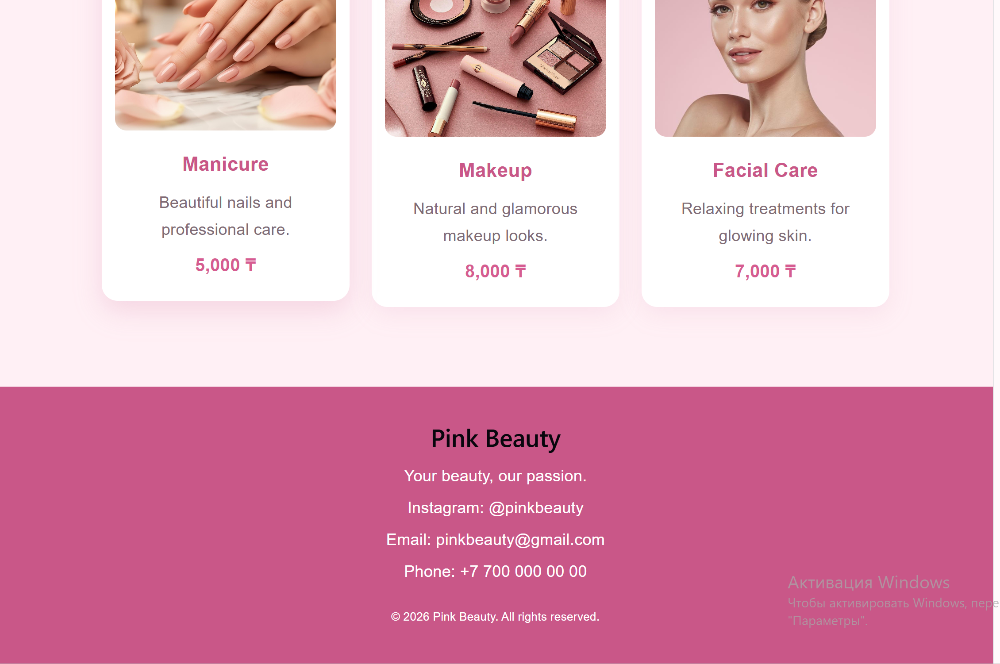

# Pink-beauty-website
Pink Beauty is a modern beauty website featuring manicure, makeup, and skincare services. Designed with an elegant pink aesthetic, beautiful photos, and a clean, user-friendly interface. Built with React and CSS.

🔗 [Live Demo Website](https://aanamitbek-arch.github.io/pink-beauty-website/)

## 📷 Interface Screenshots

| Главный экран (Hero) | Раздел 2 (About Us) |
| :---: | :---: |
|  |  |
| **Раздел 3 (Services)** | **Раздел 4 (Contact)** |
|  |  |

#### 📌 Key Sections
* **Hero Section:** Welcoming header with brand statement, aesthetic imagery, and call-to-action button ("Explore Services").
* **About Us / Our Story:** Introduction to the studio's philosophy, focusing on self-care, quality, and confidence.
* **Services & Pricing:** Interactive cards displaying core services (Manicure, Makeup, Facial Care) with descriptions and prices in KZT.
* **Contact & Footer:** Essential contact details including Instagram handle, email, and phone number.

---

## 🛠️ Tech Stack

| Category | Used Stack |
| :--- | :--- |
| **Languages** | React, Vite, HTML5, CSS3, JavaScript/TypeScript |
| **Design System** | Шрифты, цветовая палитра, UI-стиль |
| **UI/UX Architecture** | Responsive Grid Layout, Single-Page / Multi-Page |
| **Version Control** | Git, GitHub |

---

## ⚙️ Local Setup

To run this repository locally: http://localhost:5173/
